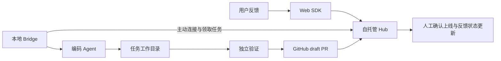

# Ploop

Turn feedback into pull requests.

Ploop 的目标是成为开发者可以自行安装、部署和扩展的开源产品，把 Web 应用里的用户反馈及相关证据交给本地编码 Agent，产出可审查的修复 PR，并跟踪修复是否发布。

当前处于方案研究阶段，尚无可运行程序、已发布安装包或真实 Agent 端到端验证。第一版目标用户已确定为其他开发者，而不是仅供作者使用的脚本。

## 推荐的第一版

- Web SDK 收集反馈原文、版本和开发者选择的上下文，支持用户上传截图。
- 可自托管的 Hub 提供工单、任务、设备、证据和 PR 状态；默认 SQLite 与本地附件目录。
- 本地 Bridge 主动连接 Hub，在显式绑定的仓库中新建 Git worktree，调用一种编码 Agent。
- 先接 GitHub 与 Codex，记录独立测试结果并创建 draft PR；人工审查、合并和确认上线。
- 从第一版提供任务去重、离线结果补报、取消、恢复及保留失败工作区的能力。

公网应用需要可访问的 Hub。开发者电脑上的 localhost 不能直接接收其他用户的线上反馈。本地试用与公网部署使用同一套 Hub / Bridge 代码，部署拓扑不同。

## 方案资料

- [产品与技术方案](docs/方案.md)：路线比较、MVP 范围、架构、数据与协议、安装体验和主要取舍。
- [实施与验收路线](docs/实施路线.md)：先验证什么、分阶段交付什么，以及发布前的通过条件。
- [公开证据与复用边界](docs/research/公开证据.md)：Gleap Bridge 固定版本检查、官方 Agent 文档和尚未验证的结论。
- [来源清单](docs/research/sources.json)：固定包版本、摘要、来源链接及本地环境观察。

方案日期：2026-11-03。文中的技术选择是设计建议，范围与验收通过后再锁定依赖版本和公共接口。

## 名称与开源发布

Ploop 作为品牌名保留。npm 的非 scoped 包 `ploop` 已存在；实际发布包需要选择维护者控制的 scope 或其他可用名称。查询到 `@ploop/cli` 返回 404，并不证明维护者拥有 `@ploop` scope。

研究阶段不复制 Gleap 的 runner、提示词或界面资产。项目许可证在开始发布自有实现前确定，并核对实际引入的第三方依赖；本目录当前没有授予任何第三方代码新的许可。
