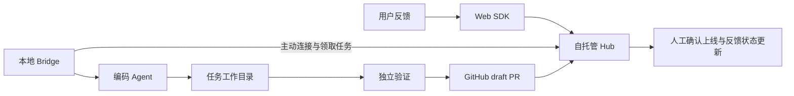

# Ploop

Turn feedback into pull requests.

Ploop 的目标是成为开发者可以自行安装、部署和扩展的开源产品，把 Web 应用里的用户反馈及相关证据交给本地编码 Agent，产出可审查的修复 PR，并跟踪修复是否发布。

当前有一个可运行的 M0 CLI PoC：合成反馈 → 本地 Codex → 独立验收 → 生成修复补丁。2026-11-03 已完成一次真实 Codex 调用，8 项验收从 5 项失败变为全部通过。它仍不是可供生产部署的 Hub / SDK / Bridge 产品，也没有已发布安装包。

## 运行 PoC

需要 Node.js 22+、Git、tar，以及已通过官方方式登录的本地 Codex。当前实测 Node 22.11.0、macOS arm64、Codex CLI 0.166.0-alpha.5.1。其他平台与版本尚待验证；项目没有第三方 npm 运行依赖。

```bash
npm test
npm run doctor
npm run poc
```

`npm run poc` 会发起真实模型调用，消耗所选账户或 API 的额度。它创建一个带已知 Bug 的示例仓库，在独立 worktree 中运行 Codex，再对冻结 commit 的快照执行外部验收；所有运行结果保存在 `.ploop/runs/`，不会自动推送或创建 PR。

详细选项、数据文件及限制见[运行说明](docs/运行PoC.md)。首次真实调用的[验证记录](docs/verification/poc-2026-11-03.md)保留了耗时、tokens、验收结果和补丁摘要。示例 Bug 和反馈都是刻意构造的案例，不代表真实客户或通用修复成功率。

## 推荐的第一版

- Web SDK 收集反馈原文、版本和开发者选择的上下文，支持用户上传截图。
- 可自托管的 Hub 提供工单、任务、设备、证据和 PR 状态；默认 SQLite 与本地附件目录。
- 本地 Bridge 主动连接 Hub，在显式绑定的仓库中新建 Git worktree，调用一种编码 Agent。
- 先接 GitHub 与 Codex，记录独立测试结果并创建 draft PR；人工审查、合并和确认上线。
- 从第一版提供任务去重、离线结果补报、取消、恢复及保留失败工作区的能力。



公网应用需要可访问的 Hub。开发者电脑上的 localhost 不能直接接收其他用户的线上反馈。本地试用与公网部署使用同一套 Hub / Bridge 代码，部署拓扑不同。

## 方案资料

- [产品与技术方案](docs/方案.md)：路线比较、MVP 范围、架构、数据与协议、安装体验和主要取舍。
- [实施与验收路线](docs/实施路线.md)：先验证什么、分阶段交付什么，以及发布前的通过条件。
- [公开证据与复用边界](docs/research/公开证据.md)：Gleap Bridge 固定版本检查、官方 Agent 文档和尚未验证的结论。
- [来源清单](docs/research/sources.json)：固定包版本、摘要、来源链接及本地环境观察。

方案与 PoC 日期：2026-11-03。下述组件和分发方式是产品目标；本次 CLI 只验证其中的本地修复路径，运行时尚未采用 SQLite，也未实现分布式队列。

## 名称与开源发布

Ploop 作为品牌名保留。npm 的非 scoped 包 `ploop` 已存在；实际发布包需要选择维护者控制的 scope 或其他可用名称。查询到 `@ploop/cli` 返回 404，并不证明维护者拥有 `@ploop` scope。

Ploop 自有实现使用 [MIT 许可证](LICENSE)。本项目没有复制 Gleap 的 runner、提示词或界面资产，也没有打包 Codex。未来实际引入第三方组件时需逐项核对其具体版本与许可来源；Ploop 的许可证不改变第三方软件的许可。
