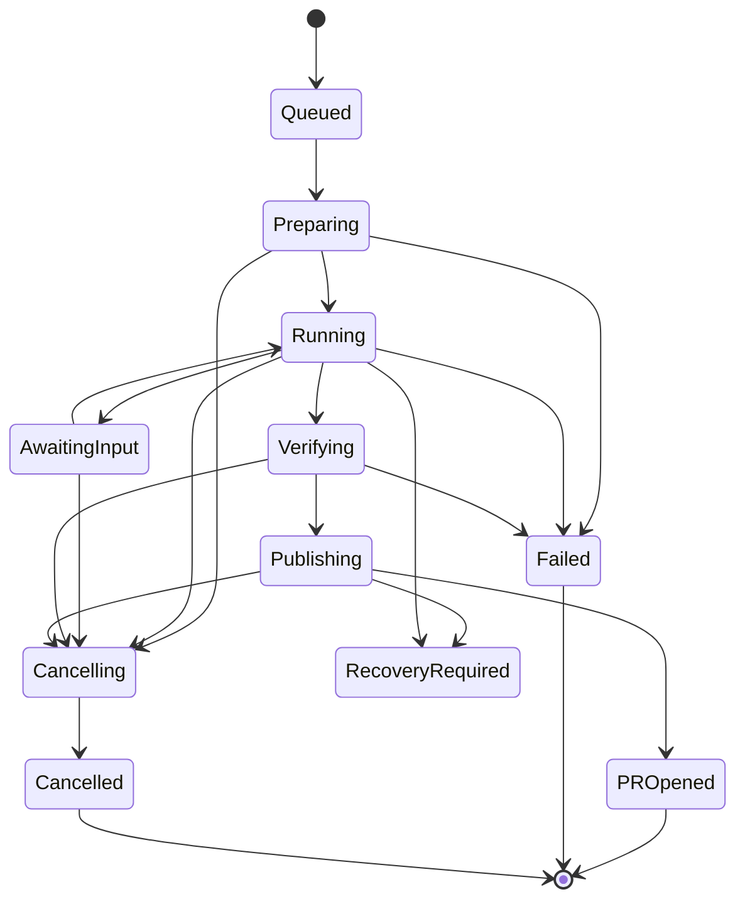

# Ploop 产品与技术方案

日期：2026-11-03。定位：面向其他开发者的可安装开源产品。本文的架构和接口均为方案，尚未实现。

推荐先做一个可自行部署的反馈修复闭环：Web SDK → Hub → 本地 Bridge → 编码 Agent → 独立验证 → GitHub draft PR。默认使用 SQLite 与本地文件存储，先支持一个 Agent 和一种 Git 托管平台。

## 1 先解决谁的问题

第一批假设用户是已有 Web 产品、代码仓库和编码 Agent 的独立开发者及小团队。他们当前需要把用户描述、截图、版本、日志和验收要求手动搬进编码工具，修复后还要关联 PR 并回复用户。这个痛点来自本次讨论；尚未做外部用户访谈，不能把它当作已验证的市场需求。

Ploop 的价值应能用一次真实任务证明：用户在出问题的页面报告问题，开发者确认处理范围，Agent 拿到必要上下文，开发者最后看到有独立验证证据的 PR。第一版不承诺任意反馈都能自动修复。

开发者采用时的三个判断是：能否顺利安装、是否愿意授权它接触自己的仓库、生成的 PR 是否减少了工作。第一轮试用需要记录这三个环节的失败原因。

## 2 六条实现路线

| 路线 | 能最快证明的价值 | 代价与限制 | 取舍 |
|---|---|---|---|
| SDK 直接生成 GitHub Issue | 反馈与证据能否帮助修复 | 自动执行、状态回传和用户跟进仍靠外部工具 | 可作为最轻的降级模式 |
| 所有组件运行在开发者单机 | 安装与本地 Agent 联动 | 线上用户无法直接访问 localhost，设备休眠即不可用 | 适合本地试用 |
| 自托管 Hub 加出站 Bridge | 公网反馈与本地编码形成闭环 | 要维护任务、权限、状态与恢复协议 | 推荐作为产品主线 |
| 复用现有帮助台，Ploop 只做 Bridge | 已有客服团队的反馈交接 | 安装依赖现有系统，数据语义和界面受其约束 | 后续做接入插件 |
| GitHub Actions 执行修复 | 无常驻本地设备的任务执行 | 依赖 CI 环境、凭证和执行成本，与本地登录复用不同 | 后续可替换执行端 |
| 同时建设完整客服平台和云端编码 | 全部体验可集中控制 | 客服、权限、多租户、计费、沙箱和运维同时扩张 | 第一版暂缓 |

主线保留“只创建工单”和“导出任务上下文”的退路。信息不全、Agent 不可用或开发者不愿授权执行时，反馈仍然有价值。

## 3 第一版范围

| 第一版交付 | 之后再做 |
|---|---|
| Web 反馈表单、用户上传截图、显式传入的页面和版本信息 | 移动端 SDK、自动截图标注、持续会话回放 |
| 收件列表、工单详情、执行时间线、设备与项目设置 | 完整客服聊天、知识库、路线图、复杂团队权限 |
| 单实例 Hub、多个项目、一个管理员身份 | 多租户 SaaS、SSO、计费、集群部署 |
| 显式绑定仓库、单 Bridge 并发一个任务 | 自动扫描个人目录、多仓库任务、自动扩并发 |
| Codex 原生接口、GitHub draft PR | Claude、Cursor、ACP 通用接入、GitLab 等 |
| 人工确认任务后执行；新需求附明确验收要求 | 任意外部反馈直接获得执行权限 |
| 记录验证命令、结果、commit 与 PR 状态 | 公网预览隧道、全自动合并部署 |
| 工单内可查询发布状态，人工标记上线 | 邮件和聊天渠道自动通知 |

首个真实案例建议选择：一个可复现的 Web Bug，例如导出只返回第一页。它同时能检验反馈上下文、代码修改、独立验收和 PR 关联。

## 4 安装和部署体验

产品目标是让开发者在不安装数据库服务的情况下完成本地试用。以下命令名只是接口草案，当前不能执行，发布包名也尚未确定：

```text
ploop doctor                  检查运行时、Git、Agent 与版本兼容性
ploop hub                     启动控制台、API 与调度器
ploop bridge pair <hub-url>    通过一次性配对码绑定设备
ploop repo add <path>          显式绑定本地仓库与远端项目
ploop bridge start            以前台方式执行已授权任务
```

引导应先说明并展示数据目录、监听地址、Hub 地址、仓库和 Agent 路径，再保存配置。注册系统服务作为独立的可选步骤；卸载服务与删除反馈、日志、工作区应分开。安装过程仅安装 Ploop 自身所需内容，缺少 Git 或 Agent 时给出说明，由开发者选择其官方安装方式。

两种部署拓扑使用同一套实现：

1. 本地试用：Hub 和 Bridge 都在电脑上运行，只绑定 loopback；示例应用向它提交反馈。
2. 线上使用：Hub 部署到有 HTTPS 的开发者服务器，Bridge 在电脑或受控执行机上主动连入。Bridge 不需要开公网入站端口。

Hub 可以提供容器镜像，但不能把控制服务运行在容器中宣传成编码任务已沙箱化。远程 Hub 的登录、项目级采集配置和设备撤销必须在公开部署前可用。

## 5 系统结构和技术选择

| 模块 | 建议 | 原因与约束 |
|---|---|---|
| Hub 与 Bridge | TypeScript / Node.js，锁定经安装验证的版本 | 两端共享契约，接入本地进程和官方工具链方便 |
| Hub HTTP 服务 | Fastify 候选，单个常驻进程 | 同时承载 API、静态控制台、SSE 与长轮询 |
| 控制台 | React / Vite 静态构建 | 由 Hub 直接提供，减少部署进程 |
| 数据 | SQLite，事务保存状态、事件和 outbox | 第一版单 Hub 实例；避免先引入 Redis、PostgreSQL 和工作流平台 |
| 附件 | Hub 本地目录加数据库索引 | 上传完成后发布引用，记录摘要、大小、类型、来源和保留状态 |
| 任务下发 | Bridge 出站 HTTPS 长轮询加心跳 | 初期不需要额外实时消息系统；延迟目标通过实测确定 |
| 时间线 | Hub SSE 加可重放的事件游标 | 刷新或断线后从持久事件继续读取 |
| Agent | Codex app-server，Bridge 内用 stdio | 适合会话、审批、流式事件和取消；不直接公开 Agent 监听端口 |
| GitHub | Hub 负责 PR、webhook 与状态协调 | 编码 Agent 不必持有合并、部署或 Hub 管理凭证 |

上述框架是候选技术选择，尚未进行安装、打包或负载验证。不要为了统一未来所有后端而先建设存储插件框架。SQLite 只适合当前明确的单实例配置；WAL 依赖本机文件系统，且同一时刻只有一个写事务。[SQLite WAL](https://sqlite.org/wal.html)、[事务说明](https://sqlite.org/lang_transaction.html)

SQLite 驱动需要在 M0 定案。Node 24 的内置 `node:sqlite` 可减少独立原生扩展安装，但官方当前仍标记为 Release candidate；应把它与有预编译包的驱动做安装、升级和崩溃恢复对比，再锁定具体 Node/SQLite 组合。[Node SQLite 文档](https://nodejs.org/download/release/latest-v24.x/docs/api/sqlite.html)

建议的源码边界如下，当前不创建空骨架：

```text
apps/hub/             HTTP、管理员会话、控制台宿主和调度
apps/bridge/          CLI、设备身份、进程监督与本地 journal
apps/web/             控制台
packages/core/        工单、任务、状态变更、权限与证据规则
packages/contracts/   有版本的边界契约及验证
packages/web-sdk/     无框架依赖的反馈采集与提交
packages/agent-codex/ Codex 适配及能力检查
examples/web-bug/     可复现示例与独立验收
```

业务层依赖自身的仓库、证据和任务语义，Agent 的 RPC 字段留在适配器内。共享契约不应为了减少文件数而承载数据库、HTTP 和各家 Agent 的全部内部类型。

## 6 Agent 接入方案

Codex app-server 适合需要历史、审批和流式事件的自定义客户端；官方 SDK 更适合批处理与自动化。Ploop 需要暂停任务、接收补充、审批和取消，因此先选原生 app-server 的 stdio 路径。[OpenAI Docs](https://learn.chatgpt.com/docs/app-server)、[Codex SDK](https://learn.chatgpt.com/docs/codex-sdk)

初版路径是初始化 → 新建或恢复会话 → 启动 turn → 消费事件和审批请求 → 接收终态。具体消息类型从锁定的 CLI 版本生成；终态事件中的实际状态决定成功、失败或中断，不能以“进程输出过文字”作为成功。

认证留在用户明确选择的本地官方工具或正式授权流程中。Ploop 不上传用户的 Agent 登录文件。面向第三方应用的正式 ChatGPT 登录可另评估官方开放的授权方式；它与单纯启动本地已登录 CLI 是两种集成，不在第一版混成一个认证流程。[官方第三方接入说明](https://developers.openai.com/siwc/token-sharing-open-source/codex-app-server)

Agent adapter 只统一 Ploop 实际需要的动作：探测版本与能力、开始任务、继续任务、回应输入或审批、取消、读取结果。能力需显式声明，例如图片输入、会话恢复、流式 usage 和权限控制。不支持的能力返回明确原因。

ACP 适合后续扩展，不能假定每个适配器都有相同的模式、权限和恢复能力。当前官方文档同时存在 v1 与 v2 draft，采用时需绑定协议和适配器版本。[ACP Prompt Turn](https://agentclientprotocol.com/protocol/v1/prompt-turn)

MCP 可作为 Ploop 向外部 Agent 提供读取工单、取得附件和报告进度的接口。根据 MCP 的角色和范围，设备保活、任务领取和主动启动仍由 Ploop Bridge 负责；这是本方案的编排选择。[MCP 架构](https://modelcontextprotocol.io/docs/2026-07-28/learn/architecture)

Claude 接入放在下一阶段。其帮助中心说明订阅下 Agent SDK / `claude -p` 的用量方式，但开发者文档另对第三方产品提供登录或额度作出限制；二者不能合并推导出 Ploop 已获得同等接入资格。届时分别验证本地工具使用与正式产品接入，API key 是需要单独配置的路径。[帮助中心](https://support.claude.com/en/articles/15036540-use-the-claude-agent-sdk-with-your-claude-plan)、[开发者文档](https://code.claude.com/docs/en/agent-sdk/overview)

## 7 数据、上下文和证据

| 对象 | 拥有的事实 |
|---|---|
| Project | 采集策略、允许的来源、授权仓库、验收命令与执行策略 |
| Ticket | 反馈原文、用户补充、提交时间、客户端版本及证据引用 |
| Run | 一次明确授权的处理目标、不可变上下文版本、仓库与 base SHA |
| Attempt | 一次执行的设备、租约代次、Agent 版本、恢复 ID 和阶段 |
| Artifact | 原始输出、附件、摘要、大小、来源、截断与删除状态 |
| PullRequest | 仓库、branch、commit、PR、checks 和 merge 事实 |
| ReleaseConfirmation | 哪个修复何时被谁确认上线，及其依据 |
| WorkspaceOwnership | 完整任务身份、规范路径、Git worktree 身份、清理状态 |

`TaskContext v1` 至少携带：目标与验收要求、反馈原文、页面与应用版本、显式选择的日志、附件索引、调查结论及证据、仓库身份与 base SHA、项目指令、已有尝试的结果、最新补充。每次执行记录使用的上下文版本。

SDK 拥有采集解释，Hub 拥有任务快照，适配器拥有 Agent 格式转换。摘要必须能回到原始证据；省略、截断和不可得字段不能变成空值或“未发现”。附件先上传并核验，再生成可引用记录；不能把用户提供的任意 URL 交给 Hub 自动抓取。

原生 Agent resume ID 只是优化。它失效时，Ploop 应能从任务快照、已验证改动和历史摘要重建上下文，也要清楚标记这是一次新会话。不能宣传为自动继承开发者当前任意聊天的记忆。

浏览器上报的应用版本属于来源数据；仓库、执行路径、base SHA 和可运行的验收配置由开发者绑定的 Project 决定。客户端不能通过提交一个路径、URL 或 SHA 改变执行对象。

默认只采集反馈文字、用户选择的截图、显式配置的应用元数据和有限日志。网络正文、请求头、持续 DOM 回放等需要单独选择。认证凭证字段与开发者标记的内容在采集边界处理；不要靠猜测字段名称来大面积改写业务证据。未来采用 rrweb 时，要区分开源库与 Cloud 的默认行为，并验证动态内容、iframe 和遮罩。[rrweb 文档](https://rrweb.com/docs/)

## 8 任务交付、恢复和取消

第一版承诺可重试和可核对，不承诺端到端 exactly-once。

1. Hub 在一个数据库事务内创建 Run、初始事件和待投递记录。
2. Bridge 经设备身份领取任务；Hub 用事务比较更新签发 attempt ID、租约和递增代次。
3. Bridge 在启动 Agent 前将领取事实和工作区身份写入本地持久 journal。同一次投递重复到达时回执，不重复启动。
4. 进度与结果先进入本地 outbox，携带事件 ID、attempt ID、序号与代次，收到 Hub 确认后才清理。
5. 租约失联进入恢复核对，不能因为心跳超时就在第二台设备重新启动可能仍在运行的任务。代次校验只能挡住旧消息，不能阻止旧进程在 GitHub 上产生副作用。
6. push 和创建 PR 前核对任务仍有效。外部调用结果不明时查询 branch / commit / PR 状态后再决定重试；重发事件与重新执行代码是两件事。



这是主要路径示意，完整转换表应在实现前列出，包括 queued 直接取消、准备失败和每个阶段的失联。PR 已创建表示此次产物已交付，不表示修复已上线。Agent 完成、验证通过、push 成功、PR 创建、merge 和部署分别保留事实，展示状态由业务层统一推导。

取消覆盖准备、执行、验证、发布和最后清理。先发送协议取消，等待确认与子进程退出，再按进程所有权和平台机制回收；不能只发送信号便显示停止。用户请求取消后，默认保留本地修改；不隐式 commit / push WIP。与已发生的外部动作竞态时，记录真实结果并核对。

清理状态与执行终态分开。工作区脏、存在未推送提交、身份未知或清理失败时保留目录和所有权记录；提供查看、重试和显式删除入口。

## 9 权限和凭证的产品边界

第一版执行对象是开发者显式绑定、愿意在本机运行的仓库。反馈、附件和线上日志是输入数据，不会因为出现“请运行某条命令”就改变开发者的执行授权。

每个任务使用新 worktree；它只隔离代码工作目录。Agent 的读写范围、网络权限和审批应按锁定版本配置并实测；例如只限制工作目录写入，并不自动证明无法读取用户目录。安装依赖和测试本身会执行仓库代码，因此首次仓库绑定要展示实际执行环境，使用独立测试凭证。

Bridge 使用最小必要环境加项目显式选择的变量，不默认复制主 checkout 的所有 `.env`。平台管理、Agent 推理、Git 发布和测试应用四类凭证分别持有。Hub 管理凭证不进入 Agent；任务需要的临时凭证限定仓库和用途。

Git 发布由 Bridge 的发布阶段独占执行。Agent 与项目测试进程不能取得发布凭证，也不能借用户的 Git credential helper、SSH agent 或可读凭证绕过阶段直接 push。仅不传环境变量不能证明这个隔离已成立；必须在支持平台实测。无法落实的本机模式应只导出补丁或让开发者手动发布，不能承诺受控自动发布。发布进程使用经过核对的远端和 commit，在独立的最小环境下运行，不执行候选工作区提供的 Git hooks。

公共 SDK key 只允许写入反馈，不允许读取工单或创建执行任务。来源限制与 CORS 有助于浏览器接入，但不是认证。公网采集需有请求与附件预算、滥用限流、管理员登录和设备撤销。自动执行只在已明确授权的项目策略下开放。

提交反馈可返回一张独立的只读回执，用户凭它查询自己工单的有限状态。回执不开放完整日志、附件、设备信息或管理动作。管理员首次初始化与登录会话需要单独建立，不能把采集 key 当作管理密钥。

GitHub PoC 可以使用仓库范围的开发凭证，开源产品正式接入优先 GitHub App。Bridge 持有 push 所需权限，Hub 持有 PR 和 webhook 所需权限；具体最小权限需用真实仓库验证。webhook 先对原始 body 校验签名、持久化并去重，再异步处理。[GitHub 签名校验](https://docs.github.com/en/webhooks/using-webhooks/validating-webhook-deliveries)

## 10 验证、成本和产品判断

修复是否正确由独立验收决定。Agent 写的测试可以补充证据，但不能代替提交前已存在或维护者控制的检查。PR 中展示环境、base/head SHA、执行命令、退出码、测试覆盖范围及未执行项；缺少证据时状态保持未验证。

验证前停止或隔离 Agent 及其后台进程，冻结候选 commit。验证器从该 commit 建立独立快照，使用开发者预先认可的验收入口、测试配置和依赖版本；记录验收材料摘要及结果。Agent 修改 `package.json` 测试命令、删除测试或改测试配置，不能悄悄改变这组验收的含义。构建输出写入指定位置；源文件发生变化时使结果失效。发布推送同一个已验证 SHA，PR head 后续改变时旧结果标为过期，重新验证。

先积累一小组可公开复现的 Web 问题，分别覆盖明确 Bug、信息不足、配置问题、重复反馈、功能请求和恶意指令。把“原始描述直接交给 Agent”作为基线，与 Ploop 提供证据上下文的等价任务比较。

记录完整任务的修复正确性、人工介入次数、PR 可接受率、用户安装阻塞、tokens、耗时、CPU 和进程族峰值内存。区分冷启动与复用会话；Agent 不提供的 usage 或订阅成本应记为未知，不能填零。第一轮小样本只用来发现失败模式，不能据此宣传通用成功率。

应用自身的持久事件是事实来源。Langfuse 可以作为可选观察出口，把单次 attempt 作为 trace、同一工单多次运行关联起来；外部观测服务不可用时任务仍需可执行和可恢复。只导出开发者选择的内容及工具公开提供的可观察输出。[Trace 范围](https://langfuse.com/docs/observability/best-practices)、[评估方式](https://langfuse.com/docs/evaluation/overview)

## 11 尚待验证的关键假设

| 假设 | 最便宜的验证 | 不通过时的处理 |
|---|---|---|
| 开发者愿意常驻一个 Bridge | 找少量目标开发者完成安装、授权和卸载 | 优先 Issue 导出或 CI worker 路线 |
| 证据能提高可审查 PR 的质量 | 同一问题对照纯文本基线和证据包 | 调整采集与任务生成，不先叠加更多 Agent |
| Codex 原生协议满足审批与恢复 | 固定版本真实执行开始、补充、取消、恢复 | 调整版本范围或采用官方 SDK 的批任务模式 |
| 默认存储和分发足够轻 | 干净环境安装、附件增长、重启和备份恢复 | 更换驱动或默认打包方式 |
| 单实例任务协议能抗失联与重投 | 注入断网、进程退出和发布结果不明 | 修复事实归属与恢复机制后再加并发 |

当前优先级是安装和真实修复 PoC。公开发布包证明了桥接路线存在可研究的实现，但尚未证明 Ploop 的产品假设或运行可靠性。固定证据见[研究记录](research/公开证据.md)，执行顺序见[实施路线](实施路线.md)。
